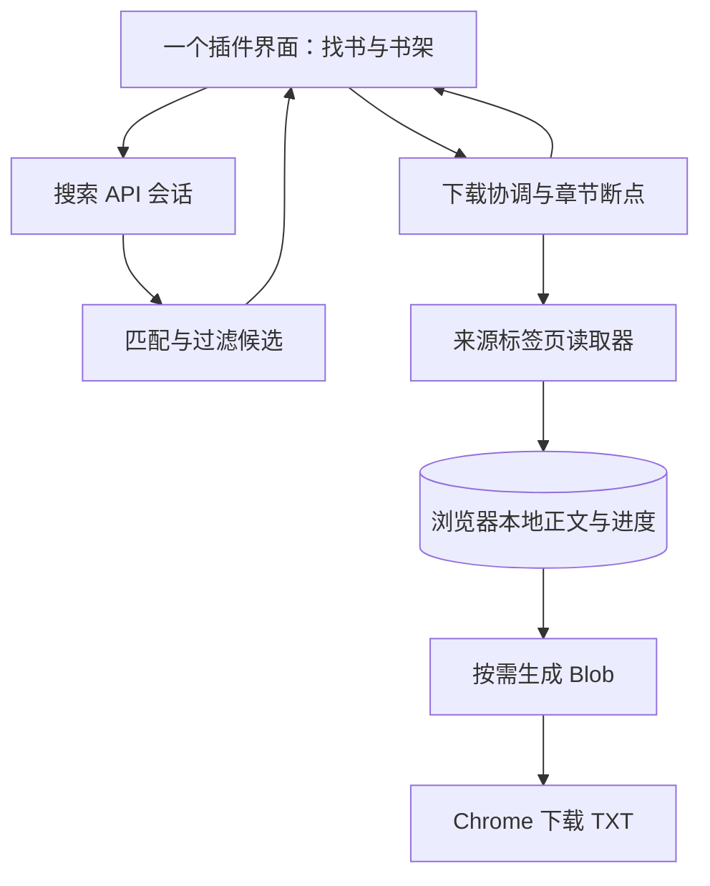

# 书页焕新计划

日期：2026-10-26。状态：0.4.1 修正作品与来源身份边界，但换源验收仍有 2 项失败，待 0.4.2 修复：Book ID 仍为本地稳定主键，只有规范化书名和作者均明确一致才复用同一作品；普通入架同一作品的不同来源复用 Book ID，同名异作者和身份不明保持独立、禁止误换源。书架与搜索结果按书名分组、作者排序，作者未知置后。其余 0.4.0 的拉黑、其他来源、入架与下载分离、独立更新目录及已确认模板净化保留。用户已指出某书后续正文污染；早先前三章读取与文件交付证据不能代表该书正文可用。整本验收尚未完成。

## 已确定的方向

新产品以完整 Chrome / Edge 扩展为主体。点击扩展图标打开完整书页；找书、书架、来源访问、章节保存和 TXT 导出都在浏览器内完成。常驻 Python / WSL 后台不再是新产品的运行前提，旧 CLI 和旧版程序保留到替换方案完成验收。

产品统一称“书页 Chrome 插件”（Chrome 官方称扩展）。交付 ZIP 是这个插件的安装包，不是还需要安装的第二个辅助插件。旧版的“当前浏览器连接器”与新产品不同；新产品不依赖它。localhost 页面只为审阅同一界面提供便利，正式入口是浏览器工具栏图标。

这取代前一轮“技术 bug 优先”的建议，也取代此前默认保留 Python 后台的架构前提。用户无需陪同逐个排查旧版错误；工程人员承担诊断、自动化检查和可独立完成的真实场景验证，用户主要判断产品体验和必要的人工站点确认。

## 产品目标与信息结构

核心路径：输入书名或链接 → 选择书籍 → 下载并取得 TXT → 后续在同一本书上继续或更新。来源和正文预览作为可查看的详情，避免每次下载都强制进入一套来源选择向导。

用户首轮原型反馈：这是自用工具，找书页应紧凑、直接，不需要宣传首页式的大标题、装饰书本和大面积留白。搜索框前置，结果采用紧凑列表；视觉设计服务于辨认状态和快速操作。

一级导航为“找书”和“我的书架”。下载动态以全局面板和底部当前下载条展示；来源诊断和低频设置进入次级入口。搜索与正在下载的书可以同时查看，操作不会强制跳入历史任务列表。

默认首页突出找书；书架从加入书籍开始就是持续入口，入架不自动下载。书架上的主操作随状态改变：下载、继续下载、前往来源页面确认、查看其他来源、导出 TXT。重新合并、缓存路径和重试参数不作为每本书并排的常用按钮。

来源确认提供作者、目录信息、实际检查状态和正文样例。元数据缺失时明确未知；不编造“最全”“最快”等推荐理由。同名书在身份没有足够证据时分别展示，来源之间不自动拼接正文。

### 一条操作主线，按结果改变状态

- 用户只发起一次下载。目录发现、正文取得、内容整理与文件生成由插件协调；用户不选择 HTTP、浏览器、验证或补缺模式。
- 正常推进、需要本人处理、部分未取得是同一下载的状态，不是三套工作流程。人工处理后继续当前书籍，补齐也延续当前进度，不要求重新搜索、换模式或另开任务记录。
- 能根据已确认的作品身份与可访问性选择来源时由插件处理；身份或版本有歧义时再让用户确认。不因来源失败而悄悄把另一作品或另一版本拼进已有内容。
- 搜索 API 不可用时保留已获得的候选并说明检索未完成；选定来源读取失败只改变该书的访问状态，不拖住搜索。API 无命中不等于站点无此书，检索失败也不能伪装成没有这本书。
- 原型的结果模拟开关已移入“原型说明 → 演示设置”，默认工具界面不再出现。正式插件不会包含这些评审开关。

目录项数量、逻辑章节数量、已保存的内容和合并章节数量各有定义。尚未完成分页识别时只称“目录项”；已识别为逻辑章节后才展示章节数。“TXT 已生成”“相对本次目录完整”“内容自检无告警”分别记录。

## Chrome 插件交互原型

目录：`prototypes/renewal/`。它既能由静态服务器预览，也能直接作为 Manifest V3 扩展加载。扩展入口只负责打开或聚焦自己的完整标签页，没有连接旧后台的逻辑，也没有真实站点权限。

原型用少量中性示例书籍演示搜索、来源比较、正文确认、排队下载、暂停继续、人工确认、部分结果、示例 TXT 导出和刷新恢复。顶部持续标明演示数据；仅在原型说明中切换模拟结果。下载进度属于模拟；浏览器中的原型状态与用户已有书架分开。

原型的成功标准是主线连贯、下一步清晰、状态不丢失、导出与声明范围一致、窄屏和键盘可操作。它不证明真实抓取成功，也不替代后续持久下载架构的验证。

## Chrome 工程样机

代码在 `extension/`，安装与凭据说明见 [样机 README](../extension/README.md)。它沿用已认可布局，增加扩展内 Key 设置和真实 DeepSeek 搜索；目录、正文、持久断点和 TXT 交付使用浏览器 API，不连接旧后台。单次下载固定前 3 个已识别章节，文件标明实际范围；这不是整本验收版本。

用户已在自己的终端通过不回显输入程序配置调试 Key。任何 Agent 均不得直接读取、回显或检查该 Key 的前缀/长度/hash，也不得转交协作者。凭据只允许程序在进程内使用；此限制持续适用于后续工作。

初期 0.2.0 校准：真实 Search 的顶层 `results` 与官方结构一致，扩展设置保存后输入清空、状态只返回是否已配置。23txxt 的临时自动化 Chrome 出现验证提示但无可操作控件，普通隔离 Chrome 的 HTTP 为 `ERR_BLOCKED_BY_CLIENT`、HTTPS 为 `ERR_SSL_VERSION_OR_CIPHER_MISMATCH`；没有降低安全设置或归咎用户未验证。该来源尚无本轮真实章节成功证据；0.3.0 的真实章节与 TXT 证据来自 wxdy，二者不能混淆。

隔离 Chrome 验证覆盖分页、原子提交失败、暂停后的迟到页面、worker 强制回收、浏览器重启、来源拒绝/关闭、下载中搜索与旧查询取消、关闭书页后生成 TXT、文件名冲突、交付不明时不自动重复导出及人工重新导出。夹具、profile 和文件均独立，真实 Key 不参与离线测试。原生页面冻结/丢弃和真实来源人工确认后的恢复仍待后续验证。

### 本书书源排除与独立入架（2026-10-25，0.4.0）

用户反馈某书后续内容被污染。页面能读、分页能收齐、TXT 字节一致，都不能证明章节正文正确；不以新增净化规则、猜测补字或前三章样机代替内容质量验收。

- 详情提供“本书拉黑此书源”，将排除记在本地这本书上。已登记别名归入同一书源；未知站只归并明确的主机展示前缀，不扩成无关域。停止当前来源的正文推进，保留已存内容与旧文件；已提交正文不会被批量清理。详情可恢复，恢复不自动开始网络访问。
- 普通搜索按确定的来源书籍身份，或完整书名且双方均明确相同的作者应用排除；作者未知时不凭同名跨作品隐藏候选。排除发生在精确匹配提前返回之前，不能因曾命中坏源停止搜索。作者/身份冲突仍阻止自动预选。针对书架这本书查找其他来源时，按该书自身的排除列表过滤。
- 书架详情始终能“其他书源”；搜索精确预选也能主动展开其他来源。若本轮只有定向结果，复用后补一次广域；已经广域的结果本地复用，展开、再次查看与刷新不追加调用。候选显示实际支持能力，没有替代结果就如实说明。换源由用户明确选择，仍保留原 Book ID；旧来源目录与正文独立保存，不按章节位置跨源拼接。
- “加入书架”只保存书籍，未适配来源也可收藏。“下载前 3 章”独立发起。更新目录只取目录、显示新增章数；分页中的草稿不会覆盖旧目录，完整目录取得后才切换快照。既有正文按来源章节 URL 复用，顺序插入或重排后仍从缺章处下载。活动下载需先暂停才可更新目录；未增加定时更新或自动下载新章。
- TXT 固定本次快照与章节 URL 范围，换源后不取旧来源章节。目录更新不会自动导出。自动构建期间若书源被拉黑或快照已切换，取消尚未交付的自动文件；此前已交付的磁盘文件保持原样。用户主动导出已拉黑来源的保存内容时，文件附有来源已被拉黑的提示。
- 确认的 wxdy 广告、重复页标题和未完提示使用同一净化模块，兼容被压成“第12页”的页码和提示粘连标题。抓取、预览及旧缓存重新导出都应用；来源元数据和文件名也清理明确的展示尾巴。正文缺字、错章及污染不推测修复；没有将用户原文写入夹具。
- 0.4.1 不改变章节表结构，也不批量合并历史重复书目。已存在书架记录保留原 Book ID、章节和文件；之后同一作品从另一来源普通入架时复用已确认作品，换源只切换当前来源绑定，不覆盖书架作品标题/作者。普通入架只复用标题和作者均明确一致的已确认作品；同名异作者、作者缺失或搜索身份冲突仍建立独立记录。书架按书名、作者排序；搜索结果按规范化书名连续分组，组内保留既有的来源/入口排序，不因作者猜测改写可下载来源优先级。
- 0.4.1 的隔离 Chrome 验收结果：17 个场景通过，2 个换源身份场景失败，待 0.4.2 修复。失败项为 `test_other_sources_reuses_search_and_switch_keeps_content_separate`（切换来源后目录被身份校验拦为 `work_mismatch`）和 `test_source_identity_requires_same_title_and_author`（拒绝响应缺少稳定 `code`）。因此“同名异作者拒绝、缺作者拒绝、同作者复用 Book ID、目录不符不改元数据”只有目录不符及其他既有场景通过，不能把整套 0.4.1 身份边界写成验收通过。Node 搜索 69/69、净化 3/3，Web/扩展 Python 53/53，两条页面端到端 UI 测试通过。

独立隔离验证覆盖拉黑时的迟到页面与自动 TXT 构建、刷新持久化、同站其他书与同名异作者、定向结果复用后仅补一次广域、原 Book 换源而不混正文、入架零访问、目录更新零正文下载及按 URL 补缺、旧缓存重新导出净化。所有浏览器夹具使用无界面临时 Chrome 和封闭外网。

0.4.0 历史隔离 Chrome 批次 15 个场景全部通过（82.751 秒），搜索与净化的 Node 回归通过；这是旧批次结果，不代表 0.4.1 两项换源失败已解决。新增场景只操作临时扩展数据；没有手工迁移、改写用户真实书架、缓存或 TXT。

deepseek 1号独立复核后另修正三个边界：来源历史连同标题和作者恢复，避免 A→B→A 后文件元数据串源；作者未知时不把同名当确定作品；自动 TXT 在 starting 记录写入后、实际发起文件下载前最后复查拉黑与快照。追加的四个针对性 Chrome 场景通过，包含暂停该数据库完成回调后插入拉黑的实际时序，以及换回旧来源后的 TXT 头与正文核对。

真实搜索复核使用程序内 Key、无界面临时 profile：原查询一次定向取得一个候选；本书拉黑后仅补一次广域，其他符合条件的候选为零；再次查看零请求，刷新保留排除。未把零结果换成未匹配网页或可疑正文，也未接入第二个搜索服务。此轮没有新增真实章节或整本下载成功证据。

0.4.0 已直接部署 `D:\Tools\shuye-renewal-engine`，13 个运行资源与安装说明共 14 文件逐个核对，manifest 最后替换；备用 ZIP 同步更新。用户真实书架排除由详情按钮触发，开发验收没有代写用户数据。关闭详情/设置、回到空闲书页后自动检查应用更新。

### 搜索体验与费用修订（2026-10-25，沿用 0.3.0 的基础规则）

用户已确认取代原“五条”规则并继续优化。0.2.1 虽通过工程回归，新截图仍暴露问答、导读、章节误命中和同站重复，不能作为小说质量验收通过的依据。0.3.0 改为以下规则，保持原紧凑布局及现有 DeepSeek。固定目录 `D:\Tools\shuye-renewal-engine` 按运行资源白名单更新、manifest 最后替换；ZIP 仅作备用。

1. 先定向已有书源，范围包括旧版明确登记的 23txxt、trxs.cc、笔仙阁、69shuba，及新增 wxdy.cc。笔仙阁两个已登记别名本地识别；有可下载的唯一确定匹配就定位，否则广域补一次。一轮最多两次、每次最多 50 条。登记与下载能力分开：新插件目前真正接入 23txxt 和 wxdy，其他三源优先发现但不启用下载。
2. 查询保留用户原词，同时加入小说、章节目录的语境；短片段不编造成完整书名。`query` 和 `ori_question` 各遵守 128 字上限。超长时先缩短意图、再缩小定向域名组合，最后才跳过定向；必要语法仍放不下则零请求提示过长，不截断书名。
3. 已登记书源须有合理书籍 URL 与作品名/作者匹配。未知站须有作者与章节、连载、完结、字数等独立作品信息组合，不能仅靠小说域名、路径或“目录”字样放行；同时使用短摘要和长摘要证据。书名匹配只看章节标题之前的作品名，正文/推荐语提及不算；清理明确 SEO 展示尾巴。推书、讨论、资讯、推广及起点/QQ 明确域名（含 `xiaoshuo.qq.com`）仍过滤。未知站不使用封闭白名单，不按房贷等剧情词禁小说。
4. 已知同一作品的目录和章节链接归并；规范书籍 ID 与访问 URL 分开，保留实际入口的协议和端口。同站优先书籍入口并轮流展示不同来源，www/m 等常见别名归为同一展示组。身份不明时只调整次序，不把不同 URL 猜成同一本书。不同作者或作品保留；同规范书籍的章节作者冲突即使章节标题未命中也纳入证据，冲突时显示作者未知并阻止自动预选。
5. 本轮筛选后的候选全部留在当前搜索会话，先展示十条，点击“更多结果”继续本地展开；返回结果、展开、收起及刷新页面复用本轮结果。只有主动重新检索才发请求。不足十条显示实际数量，不用帖子凑数，也不无限自动补搜。界面显示“筛选后共 N 条，已显示 M 条”。

真实校准：`ori_question` 单独未观察到前列样本改善，不把它宣传为已证明提效；原始低分的小说候选不能用 1.5 分阈值一刀切。目录范围 OR 语法必须实测：括号分组写法曾返回零条；改成官方示例的“原词、小说意图、site:A OR site:B”后，已有范围成功召回。短片段目前返回两条有效候选，可下载的实际目标来源排首位；全名一次定向搜索即匹配并预选。源码/夹具/文档不保存真实书名，Key 始终仅在程序内使用。

按 2026-10-25 官方标价比较，不换算汇率，也未调用竞品 API：

| 服务 | 每千次 API 请求的标价与免费量 | 本项目取舍 |
| --- | --- | --- |
| [DeepSeek Search](https://api-docs.deepseek.com/zh-cn/guides/search/) | 非空成功结果 ¥5；失败、空结果、超时不计费；取 1–50 条不改变单价 | 复用现有 Key；每轮一至两次非空成功请求约 ¥0.005–0.01。本轮定向均为空，按标价每轮只计一次广域请求。API 原始结果非空但被本地筛光仍属计费请求。 |
| [Google Custom Search JSON API](https://developers.google.com/custom-search/v1/overview) | 既有客户每日 100 次免费，超出 $5/千次；已不接受新客户，现有客户需在 2027-01-01 前迁移 | 不建议新接入；普通 Google 搜索网页体验也不能当作此 API 的实测效果。 |
| [Serper：第三方 Google SERP API](https://serper.dev/) | Starter $50/50,000 credits，公布基础价 $1/千次，未含税；credits 有效六个月；提供 2,500 次免费试用 | 这是第三方代查 Google，不是 Google 官方 API；付费入门需预购，个人小用量未必用得完，本轮只比较。 |
| [Brave Search](https://api-dashboard.search.brave.com/documentation/pricing) | $5/千次，每月 $5 免费 credits；[激活计划需信用卡](https://api-dashboard.search.brave.com/documentation/resources/help-feedback) | 小用量可落在免费量内，付费标价较高，需另开账号；本轮只比较。 |
| [Tavily Basic](https://docs.tavily.com/documentation/api-credits) | 每请求 1 credit，每月 1,000 免费 credits、无需信用卡；超出按量 $0.008/credit，即 $8/千次 | 小用量可能免费；中文小说召回与扩展可达性本轮未实测，只比较。 |

表中为各家公布的基础计费口径，不能假定其他服务也可同价一次取五十条。DeepSeek 的 Search 本身就是结构化网页搜索，不需要额外调用聊天模型。本轮使用意图参数、较大的候选批次和摘要，短摘要缺失时回退长摘要；沿用 API 返回次序并按作品匹配、书籍入口和来源调整，不另设分数阈值，权威性不代表适合下载。`need_content` 暂保留 `false`，避免五十个页面正文放大响应；另计费的 Fetch 暂不加入搜索主线，也不替代来源读取与章节完整性校验。

本批工程回归：59 项纯 Node 用例、11 个无界面隔离 Chrome 场景全部通过（最终 Chrome 批次 49.004 秒）。覆盖已有源优先和未迁移标记、小说证据、书名实词与章节误命中、50 条全量保留、十条分批及刷新零追加请求、作者冲突、目录分段断点/worker 回收、新来源按钮和 TXT、续页误标/跳号/跨书/循环、隐藏与正文外文本排除，以及原有暂停/重启/导出。自动更新还验证了新增 wxdy host 权限、设置与书籍保留。

wxdy 真实样机：普通请求曾返回 403，而正常 Chrome 无验证码即可读取；使用同一个来源标签页与内容脚本主通道接入。目录限定 `ul.mulu_list` 排除置顶最新，按连续目录页跟进“更多章节”，最新章 URL 身份已出现才停止，忽略非目录诱饵链接；本轮两页合并 179 项。正文只读 `#htmlContent.chapter-content` 可见文本，按同章网址尾号连续跟进，即便按钮误写“下一章”也不串章。缺页提示、跳号、跨书和循环不计完成。

真实从空扩展缓存完成两种验证：独立来源进入，以及一次真实 Search → 预选 → 下载 → TXT。前三章分别 6、6、4 页，TXT 32,541 字节；程序核对目录身份、页数、正文校验和及文件包含已提交正文，未复用旧缓存。测试 profile 和输出均在临时目录。另一次组合尝试曾在初始来源页出现不可读、保存 0 章，后续独立重试成功；没有把失败改称验证码或宣称绝对稳定。**这只证明前三章样机，整本 TXT 尚未验收。**

目录更新验收使用正常开发者模式的临时 Chrome：活动下载时检测到新文件版本仍保持运行，暂停后自动重载并重新打开书页，设置与书籍保留。命令行首次加载临时插件而未开启开发者模式时，Chrome 会在重载时禁用它，测试已纠正为实际安装条件。现有 0.2.0 不含更新检查，首次刷新一次书页后本版才可接管后续自动更新；用户浏览器现有调试入口不可用，未更改其配置或启停浏览器来强行激活。

## 新架构的职责

仍采用单机单用户产品，优先使用浏览器现有能力。当前工程样机使用原生 JavaScript 模块和浏览器 API，复用已确认的 HTML/CSS 布局，不引入构建依赖或通用状态、队列框架。Vue + TypeScript 是详细实现阶段可再评估的建议，不先用框架迁移扩大样机。所有可执行代码随扩展打包，不加载远程代码。

### 已确认的技术方向与样机边界

| 问题 | 推荐与代价 |
| --- | --- |
| 搜索发现 | 使用现有 DeepSeek，先查旧版四个已登记书源及新增 wxdy，优先可下载的确定匹配，再展示其他候选。每次最多 50 条、首屏十条并本地展开；登记、命中和可下载分别判断。代价是依赖索引覆盖、可达性与调用额度。 |
| 来源访问 | 目录与正文首轮只用真实来源标签页与内容脚本，移植必要的站点解析规则。页面加载较重，需要保留任务标签页；速度与后台可读性由样机实测。正文普通请求加速留待有证据时再加。 |
| 下载来源 | 23txxt 保留已实现规则及离线验证，真实访问仍未通过。0.3.0 新增用户实际命中的 wxdy，已真实验收前三章；不把它冒称为23txxt成功。旧 trxs、笔仙阁、69shuba 仅先纳入发现，迁移下载需独立验证；不照搬旧 trxs 按字数分页后推测章节的做法。 |
| 下载与搜索 | 全局一次下载一本，其他书排队；搜索 API 请求独立，不等当前章或整本下载结束，也不占来源标签页。搜索服务限流与正文来源节流分别处理；选择候选后的来源检查仍遵守站点节流。 |
| 本地内容 | IndexedDB 保存正文、目录快照和断点，按章原子提交。先做当前来源，跨来源拼章、自动换源和旧书导入不进入第一批。 |
| 文件取得 | 完成下载后自动交付 TXT。只在生成文件时创建 offscreen 文档处理 Blob，由 worker 调用 downloads API；无论书页开关都走这一条导出路径。代价是增加一个有明确用途的小组件及其回收验收。 |
| 权限与容量 | 仅申请浏览器功能及已支持来源所需权限，不申请所有站点访问权。首轮不预加 unlimitedStorage；检查存储估计、申请持久化并验证实际规模和写入失败，不能把估计值当成容量保证。 |

这里的“首轮单来源”限定工程样机的目录与正文下载，不限制 API 展示多个站点的候选。Python 旧版支持某站不等于新插件已适配该站；搜索发现多个来源，也不等于已经验证这些来源都能下载。

### 搜索 API 与匹配规则（2026-10-25 确认方向）

“已有站点”包括旧版明确登记的四个书源，优先发现范围与新插件下载能力分开维护，不能只查询23txxt就称覆盖已有站点。用户最初提出五条，随后已确认改为取足候选、筛选后分批展示。

1. 已登记书源的链接直接识别，不调用搜索；未迁移来源仍明确不可下载。书名先做已有范围 OR 检索；可下载来源准确匹配且无身份冲突时直接预选，用户发起下载才创建作业。
2. 完全匹配仅处理书名号、空白及已知站点标题后缀等展示差异，不删改书名实词、用相似度冒充相同作品，或擅自把繁简名称当同一版本。作者/版本存在冲突或不能区分多个同名作品时，保留选择；缺失字段显示未知。
3. 定向未获得确定的可下载匹配时，再广域一次。候选先按可下载、其他已有源、未知源排序；全部有效候选保留，十条分批展开。原始每次最多50条、正常最多两次请求，不为凑数反复调用。
4. 起点、QQ 阅读的站点域名及相应子域纳入明确排除清单，API 侧排除与本地 URL 主机名复核共同执行。按准确域名/子域边界判断，不按标题提到平台名或 URL 字符串包含关系误删，也不笼统排除整个 qq.com。其他平台逐项补充清单，不自动扩大成集团级排除。已知书源的目录/章节链接归并为同一候选，不能仅按“书名＋站点”吞并不同作者、版本；未知身份不猜合并。
5. 检索期间不逐条打开来源检查目录或首章，以免来源验证再次阻塞搜索。结果只根据证据标明“已适配”“尚未支持此站点”或“身份待确认”；已适配不代表本次正文已可读。用户选择后才读取该来源，人工处理、正文未取得和继续仍归属同一本书。未适配候选可以展示，但首轮不伪装成可下载或顺带建设万能解析器，不要求用户换到另一工具重试。
6. API 超时、认证失败、限流、额度不足与正常空结果分别说明，不自动回退逐站搜索或切换另一 API。摘要、API 的相关性分数和引用片段只辅助选书，不作为正文、完整性证据或作者身份保证。

用户已选择复用现有 DeepSeek 官方模型 API Key。独立搜索使用 `POST https://api.deepseek.com/v1/tools/search`，与模型使用相同 Bearer 鉴权，取得结构化候选，不调用聊天模型或 Fetch API。每次 `count: 50, need_content: false`，使用 `site:`、`-site:`、短语和小说意图；query 连同操作符最多 128 个 Unicode 字符。放不下可选排除语法时保留完整书名并本地过滤，不截断书名或增加无上限查询。其他服务只作文档评估，不同时接入或自动切换。

2026-10-25 官方中文价格为每 1,000 次产生非空结果的成功搜索 5 元，无结果和失败不计费；这是接口标价，不承诺现有账号余额或优惠。可达性与扩展直调已有真实技术查询证据，真实中文书目召回和完整下载仍需继续验收。Key 在扩展设置一次、本机保存、仅用于认证 header，不进入安装包、来源内容脚本、TXT 或诊断；不增加常驻后台，也不要求另注册搜索服务。

### 浏览器执行与生命周期

- Manifest V3 service worker 协调事件和浏览器 API，每个章节步骤有界，先保存请求意图，再请求、校验、保存正文和断点。任务不以 service worker 全局变量作为唯一状态。
- Chrome 可能在空闲或长请求时终止 worker，不能承诺一个内存循环永远运行。通过持久检查点、浏览器事件及必要的 alarms 恢复调度；正常章节推进不依靠逐章 alarm 等待。alarm 不是保活或准点保证，worker 启动时核对并补建必要的 alarm；工程样机必须在关闭调试器时强制终止 worker，验证正文、进度和文件交付的恢复。
- 第一轮目录与正文工程验证统一以来源标签页和内容脚本读取为主，来源规则在真实页面环境中提取内容。暂不同时建设几套正文请求、页面仿真和失败后自动换通道的链路。代价是页面加载更重、需要管理少量来源标签页，可靠性与速度均须实际验证。
- 正文普通扩展请求只作为以后有实测依据时的优化，不作为首轮必须建设的第二读取通道；搜索 API 的 HTTP 请求属于发现链路，独立执行。通道选择不交给用户。
- offscreen document 只为自动 TXT 交付按需创建，使用官方 BLOBS 用途，不参与来源读取、调度或保活。正文从扩展自己的 IndexedDB 读取；生成、重新导出复用同一实现。下载完成或中断后释放 Blob URL 并关闭文档，不能在 downloads 刚返回 ID 时立即回收。
- 搜索会话与持久下载队列分离。搜索默认不创建来源标签页；同一时刻只有一个活动下载标签页，暂停的来源页可保留，同一标签页最多一个导航或读取操作。选择候选后的来源检查归属明确，不得导航正在读取正文或等待本人处理的标签页。不同标签页不代表站点 Cookie 或验证态隔离，不能承诺一次人工确认永久有效。正文站点节流仍由协调器执行。
- 来源标签页由插件管理，平时后台使用和复用，需要用户操作时才提示前往。需要人工处理时显示来源与下一步，处理完成后继续同一作业；不自动弹出一排验证页面。程序不代替用户点击浏览器安全提示或解决验证码。
- 目标是在浏览器运行且任务标签页可读时，关闭书页界面仍能继续下载并自动交付 TXT；后台冻结、丢弃页面或系统休眠可能使其暂停，不能承诺持续满速。页面被丢弃可重新加载插件自己的来源页并恢复检查；被冻结且无法读取时保留断点并说明需恢复来源页，不冒称验证码。用户关闭或改导航任务标签页时暂停当前书，点继续后重新取得专用标签页，不反复抢回用户页面。退出 Chrome 后停止网络活动并保留断点，重新打开后显示待继续，不自行重启网络下载。这些运行行为均须样机证明。

以上方向已进入工程样机，已验证范围见本页“Chrome 工程样机”；尚未通过的真实来源、完整性与生命周期场景继续保留，不能只因界面推进进度或夹具通过而宣布实际可用。

### 持久模型

| 实体 | 用途与身份 |
| --- | --- |
| Book | 用户书架中的一本书，以本地 ID 标识，书名不作主键 |
| BookSource | 一个确定的站点版本及规范目录 URL，归属某本书 |
| SourceSnapshot | 一次目录发现及其条目、分页与逻辑章节识别结果 |
| ChapterRecord | 来源内的章节身份、已取得页面及正文、校验和，防止跨来源覆盖 |
| Job | 一次下载或更新的意图、所选来源、范围、阶段和断点 |
| Artifact | 已构建的 TXT 版本、来源快照、内容范围、已知缺失、自检提示和下载记录 |
| DiagnosticEvent | 阶段、目标 URL、原因、时间与请求归属，保留具体失败证据 |

正文与元数据放入 IndexedDB；低频设置用 `chrome.storage.local`。每次完成章节与断点更新必须一致提交。书架展示当前可用内容和推荐操作，历史 Job 保留排查价值。完整结果和新的部分结果分别标识，保留之前可用的成果。

上表是数据职责，不要求七套服务或通用仓储层。首轮可把来源和目录快照放在书籍、作业记录中。请求只带必要的作业、来源、章节 URL、目标标签/文档和本次尝试编号；返回时及提交事务内复核归属、尝试编号与作业状态，旧响应不得推进已暂停、替换或结束的作业。不能只看域名或标题相同就写入正文。

本次作业固定目录快照，章节身份以来源和规范 URL 标识，序号只用于排序。章内分页必须全部取得并校验后才提交；中断可重读当前未提交章，已提交章跳过。23txxt 出现续页循环、跨作品/目录或非递增页号时停章并记录；正文仍提示本章未完却无合法续页链接时保持未完成，不能只因链接消失就判章末。未取得的目录项不生成占位正文，也不直接按目录数宣称完整章数。事务失败时正文和断点均不得前移，按具体存储错误显示原因，不误报需要人工确认。后续目录变化另建快照，不能直接把旧位置当作同一章。

### 文件与旧数据

TXT 通过 Chrome downloads API 导出，可选浏览器下载目录内的子路径或用户另存为。扩展不能静默写任意 WSL 绝对路径；文件位置、打开目录和冲突命名由浏览器下载记录管理。书架移除、清理扩展内正文和磁盘导出文件是不同动作。

正常完整下载结束即导出；部分结果明确缺失范围，用户可取得已保存内容并在原书继续补齐。Artifact 先保存本次内容版本和导出意图，生成后记录 Blob URL 与 Chrome downloadId，以下载记录的完成状态确认文件交付。worker 恢复后先对账，不盲目再次导出。调用与落库之间崩溃等情况若无法对账，保留正文并标记“文件交付待确认”，允许用户重新导出；不承诺跨数据库与浏览器 API 的绝对单次执行，也不把“正文齐了”直接当作磁盘文件已保存。回收前若下载状态不明，应先对账或取消并确认中断，不能仅凭超时就撤销仍在使用的 Blob。

旧版 cache、TXT、来源文件和任务记录保持原样。导入采用用户选择文件/目录或一次性导入包，生成新的身份映射与报告；扩展不声称能直接扫描 WSL 文件系统。已有 TXT 没有已知缺失但未经核验时标“完整性未核验”，有明确缺失才标部分结果。旧缓存 URL 被覆盖、正文来源已无法辨认的污染不自动猜测修复。

### 原因分类

至少区分搜索服务认证失败/限流/额度不足/超时、正常无候选，以及来源访问被拒绝、权限待授权、需要人工确认、导航超时、页面不可读、内容结构不匹配、正文不完整、本地存储失败和用户暂停。对每次请求记录来源、阶段、URL、时间和原因；终态保留原因，不用一个“访问受阻”覆盖全部情况。页面只突出与用户下一步有关的信息，原始证据放在下载详情。

## 后续交付与验收

1. 交互原型：审阅默认首页、搜索确认、书架状态和文件取得的连续性；结合用户反馈收敛，避免在原型确认前重写所有旧模块。
2. 扩展工程样机：建立最小生产目录和持久模型，验证权限、真实来源标签页、跨章读取、worker 回收恢复、正文持久化与 TXT 导出。开发人员先自行验收，只有站点要求真人确认时再请用户介入。
3. 单来源完整链路：从独立空缓存完整取得一部适当规模的公开书目；同时验收搜索不被长下载堵住、暂停继续、人工处理与具体错误可追溯。少量章节样机不得算作整本成功。
4. 来源扩展与旧书导入：加入第二个可下载来源检验读取边界，区分搜索已发现与实际已支持；对旧数据执行只读识别、导入预览和抽样一致性核对。
5. 切换与体验优化：在新方案有真实成功证据后切换日常入口；用户体验反馈进入下一轮，保留旧版回退和文件导出能力。

既有 Python 解析、净化和缓存迁移行为作为已知样例和对照依据；可复用逻辑需明确移植，不把旧模块简单包在扩展后面。新增验证对应真实风险；原型不改动旧生产程序，所以不以重复运行旧回归来证明新原型的交互正确。

### 下一批工程样机的通过条件

用户已授权执行以下清单。deepseek 1号负责限定的搜索规则、已登记来源识别、离线测试与中性夹具，并只读复核 wxdy 的目录连续性；指挥窗口负责集成、来源读取/存储/导出、凭据程序、真实验收及部署。实际 Key 不在协作者读取或派工范围内。

| 风险 | 最小验证与通过依据 |
| --- | --- |
| 新插件实际仍依赖旧后台 | 用独立临时 Chrome profile 加载新 MV3 插件，旧后台与连接器均不参与。真实完成搜索 API 候选发现和直接粘贴链接识别、目录与明确标注范围的少量章节读取、正文持久化、TXT 文件交付。23txxt 样本须含多页章；按公共续页链接验证收齐，拒绝把下一章或别本书误当续页。实测请求耗时、内存与存储用量，不先承诺速度。 |
| 中断后漏章、错章或假完成 | 在正文提交前和提交后分别终止 worker，包含当前未提交章的重复读取、事务失败和旧尝试响应迟到；恢复后章节 URL、正文与断点一致，已完成章不重写、无重复追加或错章。Chrome 重启后保留待继续。 |
| 标签页与人工处理打断主线 | 关闭书页、关闭或改导航来源页、触发丢弃/冻结，分别检查继续或暂停状态；仅有真实站点/浏览器提示才请本人处理，完成后继续原书。普通超时、结构不匹配和存储错误保留各自原因。安全提示与验证码不由程序代点。 |
| 搜索误选、结果不足或伪装可下载 | 检查已适配确切匹配预选、同名作者/版本歧义、链接绕过 API、已知章节链接归并，以及未知站点支持标记。五十条原始候选筛选后完整保留，首屏十条、本地展开和刷新恢复不得追加 API 请求，不足如实显示；起点/QQ 阅读准确域名及子域排除，不误伤相似域名。先用中性离线样本验证规则，之后用实际中文查询核对召回、耗时、调用次数与 credits；不能以离线规则通过替代真实 API 效果。 |
| 搜索受来源阻塞或失败被当成无书 | 来源正在读慢章或等待人工处理时发起搜索，API 仍能独立返回；检索阶段没有逐条开站检查。用真实 API 响应的脱敏样本校准字段和错误解析；离线入口固定为不可回落真实服务的替身，验证认证失败、限流、额度不足、超时及空结果分别呈现，不启动逐站搜索/第二服务或误触发下载。新查询/停止后迟到的旧响应不得覆盖当前结果。 |
| 正文成功但文件未交付 | 关闭书页后完成导出，检查文件字节与已提交正文一致；导出前后回收 worker、在下载中断及文件名冲突时核对状态，确认不会静默重复导出或覆盖旧成果。验证 Blob 有效期及终态后 offscreen 已关闭。 |
| 少量章被当作整本成功 | 样机通过后，从新扩展独立空缓存取得一部适当规模的公开书目完整 TXT，固定来源和本次目录快照；逐章核对身份、取得范围、分页收齐、重复与缺失，抽查首中末正文和文件内容。不读旧缓存填数，未知范围如实标注，未确认的分页边界不能计为完整。 |

上述验证由工程人员执行并记录实际结果；用户只确认方案、体验，以及确实无法代办的来源人工操作。离线夹具、旧缓存和少量章节通过都不能替代最后一行。

## 官方能力依据

- [DeepSeek 网页搜索与抓取](https://api-docs.deepseek.com/zh-cn/guides/search/)：独立搜索接口、同一官方 API Key、results 结构、查询语法、128 字符上限、错误和计费；本插件仅使用 Search。
- [Chrome service worker 生命周期](https://developer.chrome.com/docs/extensions/develop/concepts/service-workers/lifecycle)：后台可能终止，进度必须持久化。
- [Chrome alarms API](https://developer.chrome.com/docs/extensions/reference/api/alarms)：仅作事件调度兜底，可能延迟，启动时应核对关键 alarm。
- [Chrome scripting API](https://developer.chrome.com/docs/extensions/reference/api/scripting)：脚本注入需要对应权限，结果可关联具体文档。
- [Chrome tabs API](https://developer.chrome.com/docs/extensions/reference/api/tabs)：页面可能冻结或丢弃，标签 ID 仅在浏览器会话内标识页面。
- [扩展存储](https://developer.chrome.com/docs/extensions/develop/concepts/storage-and-cookies)：IndexedDB 与扩展页面共享；worker 不能使用 Web Local Storage。
- [扩展跨域请求](https://developer.chrome.com/docs/extensions/develop/concepts/network-requests)：站点请求依赖相应 host permissions。
- [Chrome downloads API](https://developer.chrome.com/docs/extensions/reference/api/downloads)：导出与保存位置使用浏览器下载机制。
- [Offscreen API](https://developer.chrome.com/docs/extensions/reference/api/offscreen)：BLOBS 明确包含 Blob 与 URL.createObjectURL；offscreen 内只支持 runtime 扩展 API，由 worker 负责 downloads 调用。
- [Vue 官方介绍](https://vuejs.org/guide/introduction.html)：组件与响应式界面作为生产 UI 的建议基础。
